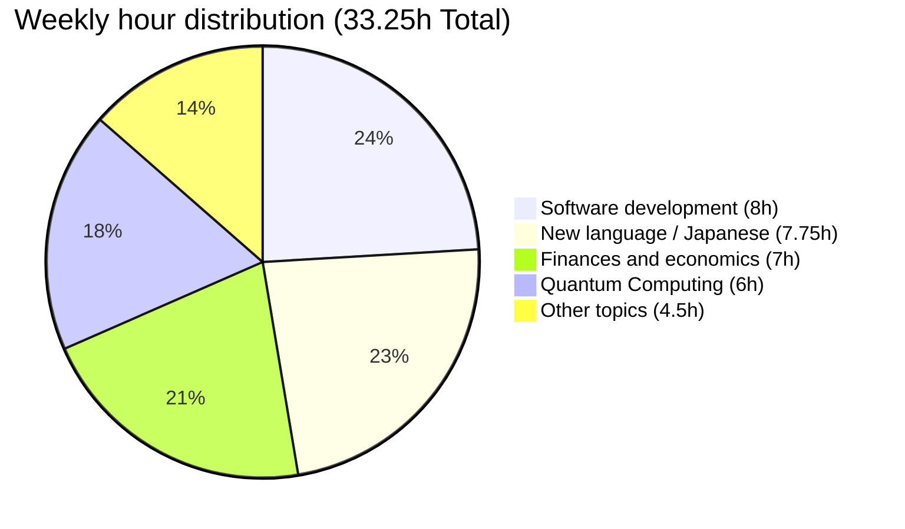
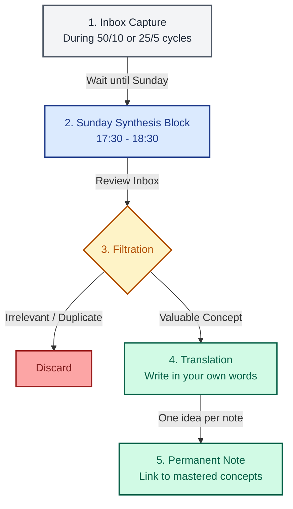

# 🧠 Master Study Vault & Knowledge System

Welcome to the central nervous system for your studies. This vault is designed to support a rigorous 4-hour daily study habit (totaling 33.25 hours/week) alongside an 8-hour workday, focusing on transitioning to Senior/Staff engineer, learning Japanese, mastering economics, understanding Quantum Computing or basically polymath  learning.

## 📊 Weekly Study Distribution

## ⏱️ Time & Cognitive Energy Management

To sustain 4 hours of daily study without burning out, sessions follow strict time blocks based on the subject's cognitive load:

- **High-Load Blocks (50/10 Cycles):** 50 minutes of absolute focus followed by a 10-minute break. Used for complex subjects like Quantum Computing and Software Architecture. This prevents breaking your state of flow just as you load complex context into your working memory.
    
- **Dynamic Blocks (25/5 Cycles):** 25 minutes of focus followed by a 5-minute break. Used for subjects studied later at night (20:45 - 22:45), such as Languages and Finance. This shorter cycle keeps an agile pace when accumulated fatigue is highest.
    
- **High-Quality Rest:** During breaks, strictly avoid "cheap dopamine" (social media, short videos). Look out a window, hydrate, or walk around to give your prefrontal cortex the visual silence needed to consolidate information.
    

## 📅 Full Weekly Schedule

### Weekdays: Work & Intensive Study (Mon-Fri)

| **Time**          | **Activity**               | **Focus / Details**                                                                       |
| ----------------- | -------------------------- | ----------------------------------------------------------------------------------------- |
| **07:30 - 08:30** | Breakfast & Warm-up        | Light review (Language flashcards or reading a non-technical chapter).                    |
| **09:00 - 17:00** | Work                       | Full-time engineering workday.                                                            |
| **17:00 - 18:30** | Disconnect & Exercise      | Walk, dinner, and mental reset. Separating work from study is vital.                      |
| **18:30 - 20:30** | Study: Block 1 (High Load) | **Software Architecture / Quantum Computing.** (Requires math and complex system design). |
| **20:30 - 20:45** | Break                      | Active pause. Hydrate and step away from screens.                                         |
| **20:45 - 22:45** | Study: Block 2 (Dynamic)   | **Finance / Language.** (More applied concepts and spatial/visual memorization).          |
| **22:45 - 23:30** | Leisure & Free Reading     | Video games, music, poetry, or tarot. Transition to sleep.                                |

### Saturday: Deep Practice, Laboratory & Immersion (5 hours of study)

- **08:30 - 09:30 | Breakfast & Warm-up:** Unrushed start, coffee, and light vocabulary review (Anki).
    
- **09:30 - 11:30 | Block 1: Engineering & System Design Lab (2h):** Applied practice (designing distributed architectures, writing characterization tests, prototyping microservices, or practicing high-level interviews).
    
- **11:30 - 12:00 | Active Break:** Stretching and screen break.
    
- **12:00 - 14:00 | Block 2: Quantum Computing & Practical Cryptography (2h):** Linear algebra problem solving or implementation of quantum circuits and algorithms in code (Qiskit/Cirq).
    
- **14:00 - 16:00 | Lunch & Disconnection:** Quiet meal away from the desk.
    
- **16:00 - 17:00 | Block 3: Cultural Immersion & Language (1h):** Consumption of native content (music, reading, podcasts, or active listening practice).
    
- **17:00 onwards | Free Evening & Night:** Long walk, a good pasta with wine, video games, or cultural outings.
    

### Sunday: Financial Strategy, Polymath Exploration & Synthesis (4.5 hours of study)

- **09:00 - 10:00 | Quiet Breakfast:** Relaxed start to the day.
    
- **10:00 - 12:00 | Block 1: Finance, Macroeconomics, DeFi & Portfolio (2h):** Weekly market analysis, tracking investment strategy (ETFs, DCA, yields in stablecoins/RWA), and technical study of blockchain protocols.
    
- **12:00 - 12:30 | Active Break:** Coffee or short walk.
    
- **12:30 - 14:00 | Block 2: Polymath Exploration (1.5h):** Space dedicated exclusively to your alternative reading list (occultism and symbolism, pure mathematics, semiotics, analytical psychology, or cybernetics).
    
- **14:00 - 17:30 | Sunday Lunch & Recreation:** Physical maintenance walk and free time for video games.
    
- **17:30 - 18:30 | Block 3: Weekly Synthesis & Language (1h):** 30 minutes of grammar/kanji review and 30 minutes to consolidate notes of everything learned in the week, leaving Monday's objectives ready.
    
- **18:30 onwards | Night Decompression:** Video games, relaxing music, and early rest to start the week at 100%.
    

## ⚙️ Retention & Execution Protocols

Taking notes is only step one. Mastery requires active retrieval and practical application:

- **Active Recall & Feynman Technique:** Never passively reread or highlight text. After reading, close the source and attempt to explain the concept from scratch. Your explanation must be simple enough to teach a beginner.
    
- **Spaced Repetition (Anki):** Use Anki during your morning routine (08:00 - 09:00) to review Japanese kanji, quantum computing formulas, and system design patterns.
    
- **Project-Based Learning (From Book to Repo):** For technical concepts, immediately build a minimal proof of concept. If you read about message queues, spin up a quick Docker environment; if you study quantum gates, write a Python script using Qiskit.
    

## 🔄 The Zettelkasten Workflow: Entry Life Cycle

### The Inbox-to-Permanent Flow

1. **Inbox Capture (Weekdays):** During your high-load (50/10) or dynamic (25/5) study blocks, you will encounter rapid ideas, formulas, or connections. You dump these into your Inbox to avoid breaking your state of flow.
    
2. **Sunday Synthesis Block (17:30 - 18:30):** You leave the Inbox untouched until Sunday at 17:30. During this 1-hour block, you sit down specifically to consolidate everything learned during the week and clear the Inbox to zero.
    
3. **Filtration:** You review each rough idea. If an idea no longer makes sense, is easily found in documentation, or is not relevant to your core goals, you delete it.
    
4. **Translation (The Golden Rule):** For the concepts that survive filtration, you must translate them into your own words. You are strictly forbidden from copying and pasting text directly into a Permanent Note. You must also ensure that each note is atomic, containing only a single idea.
    
5. **Permanent Note Integration:** The final step is linking. Once the atomic note is written, you must connect it to concepts you already master to cross paradigms. For example, if your Inbox note was about an economic concept from your DeFi studies, you might link it to a Permanent Note about cognitive biases from behavioral economics.
    

## 📚 Curriculum Inputs (Current Reading List)

- **Software Architecture and coding:** 
  - [ ] _AI in AWS_
  - [ ] _Software Architecture_
  - [ ] _Designing Data Intensive Applications_
  - [ ] _The Pragmatic Programmer_
  - [ ] _System Design Interview_
  - [ ] _Software Architecture the hard parts_
  - [ ] _Software Architecture Patterns_
  - [ ] _Release It! Design and Deploy Production-Ready Software_
  - [ ] _Observability Engineering Achieving Production Excellence_
  - [ ] _Design Patterns_    
    
- **Quantum Computing:** 
  - [ ] _Computation Conferences_ (Feynman)
  - [ ] _Quantum Supremacy_ (Kaku)
  - [ ] _Linear Algebra Done Right_ (Axler) 
  - [ ] _Quantum Computing: An Applied Approach_ (Hidary) 
  - [ ] Quantum Computation and Quantum Information_ (Nielsen & Chuang).
  - [ ] _Quantum Random Number Generators_
  - [ ] _Quantum Environments_
  - [ ] _IBM Quantum Computing Course_
    
- **Japanese:** _Genki I & II_, _Remembering the Kanji_ (Heisig).
    
- **Finance & Blockchain:** 
  - [ ] _Algorithmic Trading_
  - [x] _Cryptoassets - The Innovative Investor's Guide to Bitcoin and Beyond_
  - [x] _The Simple Path to Wealth_
    
- **Polymath Explorations:**
	- IOI teaching
	  - [ ] _Preparing for the IOI through Developmental Teaching_
	  - [ ] _Olympiads in informatics Tasks and Training Volume 1 and 2_
	- Cryptography and hacking
	  - [ ] _An Introduction to Mathematical Cryptography_
	- Math
	  - [ ] _Abstract Algebra_
	  - [ ] _Math for Machine Learning_
	- Others
	  - [ ] _Man and his Symbols_